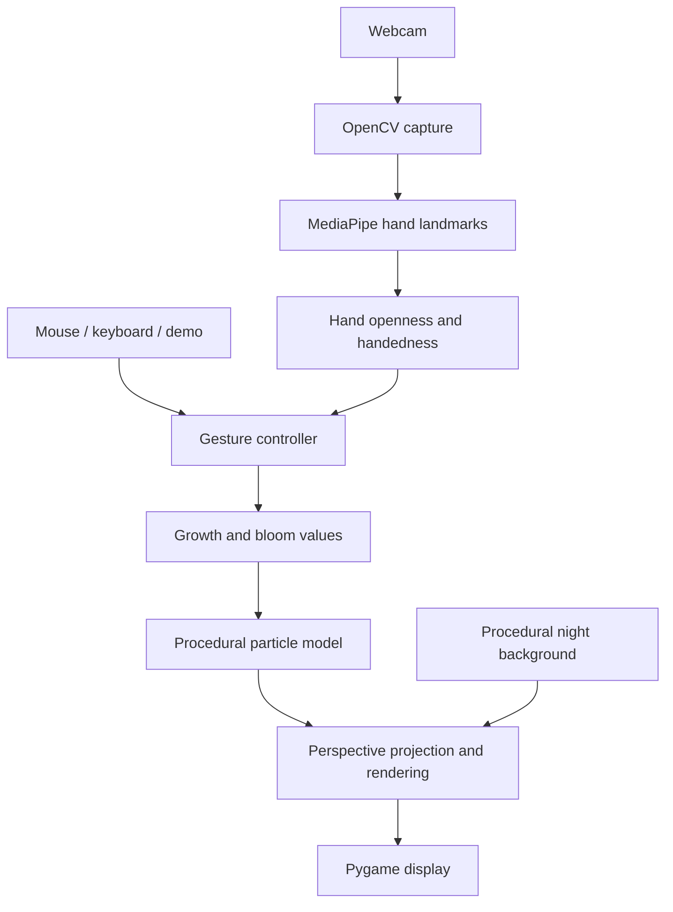

# Sundrop

*A little magic, at your fingertips.*

Sundrop is an interactive digital artwork inspired by the magical flower in Disney's *Tangled*. It combines real-time hand tracking with procedural plant geometry and particle animation, allowing users to grow and bloom a golden lily plant through touchless gestures.

## Features

- Independent left-hand growth and right-hand blooming controls.
- Procedurally generated stem, broad basal leaves, narrow stem leaves, two bloomable lilies and one permanently closed bud (as defined in the supplied flower model).
- Golden-orange petals, purple and pink centre highlights, curled stamens, flowing light pulses and drifting particles.
- Perspective projection, gentle camera movement and configurable additive glow in the supplied renderer.
- Procedurally painted lantern-night background with responsive portrait and landscape layouts.
- Background-thread webcam tracking, gesture smoothing and temporary tracking-loss tolerance.
- Mouse and keyboard fallback, scripted demo and resizable/fullscreen display.

## Getting started

Use Python 3.10–3.12 with the classic MediaPipe Hands API. The following Windows PowerShell setup uses Python 3.11 and suggested compatible dependency versions:

```powershell
git clone https://github.com/anisha-2905/Sundrop.git
cd Sundrop
py -3.11 -m venv .venv
.\.venv\Scripts\Activate.ps1
python -m pip install "numpy<2" pygame mediapipe==0.10.14 opencv-contrib-python==4.10.0.84
python main.py
```

A webcam is needed only for gesture mode. Keep the bundled `fonts/` directory in the project root. The repository does not currently include a dependency manifest; the versions above are suggested, not a verified lockfile.

## Interaction

| Gesture | Action |
| --- | --- |
| Open left hand | Gradually assemble the plant |
| Open right hand | Unfold the lilies once sufficient growth has occurred |
| Close right hand | Return the petals toward their closed pose |
| Close left hand | Reverse plant assembly toward the resting seed |
| Move hands out of view | Briefly retain the last input, then ease toward rest |

Hand openness is continuous rather than a binary gesture. Keep the left hand open while blooming for the complete effect.

### Run modes

```bash
python main.py
python main.py --mouse
python main.py --demo
python main.py --camera 1
python main.py --fullscreen
```

| Input | Action |
| --- | --- |
| Left mouse button / W / Up arrow | Grow |
| Right mouse button / Space / B | Bloom |
| F | Toggle fullscreen |
| M | Toggle manual input when camera tracking is available |
| H | Toggle gesture hints |
| Esc / Q | Quit |

## System architecture



## Implementation

**Gesture processing:** Hand openness is estimated from the average wrist-to-fingertip distance for four fingers, normalised by wrist-to-middle-finger-base distance. The ratio is mapped to a bounded value between zero and one. Exponential smoothing and separate rise/fall rates reduce abrupt changes. Blooming is gated by the current growth state.

**Plant modelling:** NumPy arrays represent particle positions, colours and intensities. Parametric curves define the stem; quadratic Bézier curves form leaves, branches and petals. Blade-width functions shape their silhouettes, while sampled edges and veins provide detail. Petal orientation and curvature interpolate between closed and open poses. Seed particles, stamens, pollen and time-dependent sway add motion.

**Animation:** Each particle has a growth threshold and a spawn position. Smooth interpolation assembles the plant progressively, with transient swirling motion, travelling light pulses and twinkling. Particle counts depend on the density setting and geometry rather than a fixed count.

**Rendering:** The supplied renderer projects 3D coordinates into screen space, distributes particle intensity across neighbouring pixels, applies nonlinear tone mapping and composites the resulting light layer over the background. Optional halos and drifting fireflies enhance the scene.

**Background:** A generated night landscape includes layered hills, trees, clouds, a crescent moon, village silhouettes and lanterns. Painting is performed asynchronously, with layout adapted to window proportions.

## Project structure

```text
Sundrop/
├── fonts/
├── .gitignore
├── README.md
├── background.py     # Procedural night landscape
├── config.py         # Visual, motion and input settings
├── flower_model.py   # Plant geometry and particle animation
├── hand_input.py     # Camera, landmarks and gesture controller
├── main.py           # Application loop and input modes
└── renderer.py       # Projection, compositing and HUD
```

## Configuration

Edit `config.py` to customise the experience.

| Setting | Purpose |
| --- | --- |
| `DENSITY` | Particle sampling multiplier; reduce if rendering is slow |
| `RENDER_SCALE`, `MAX_RENDER_LONG` | Internal rendering resolution |
| `GAIN`, `GLOW` | Brightness and optional halo strength in the supplied additive renderer |
| `FPS` | Target frame rate, not a measured benchmark |
| `SHOW_FIREFLIES`, `FIREFLY_COUNT` | Ambient firefly controls |
| `OPEN_MIN`, `OPEN_MAX`, `DEADZONE` | Hand openness calibration |
| `OPENNESS_SMOOTHING` | Input smoothing |
| `HOLD_SECONDS` | Tracking-loss grace period (0.8 seconds in the repository configuration) |
| `GROW_RISE`, `GROW_FALL` | Growth and contraction response rates |
| `BLOOM_RISE`, `BLOOM_FALL` | Petal opening and closing response rates |
| `CAMERA_INDEX`, `SWAP_HANDS` | Webcam selection and handedness correction |

The `FLOWERS` list in `flower_model.py` defines flower positions, orientations, sizes, growth thresholds and bloom eligibility. The repository configuration currently sets density to 8.0, glow to zero and includes pointillism-related settings; appearance depends on the renderer version in use.

## Troubleshooting

- Missing local imports: open the entire project folder in VS Code and ensure `config.py` and `background.py` are beside `main.py`.
- Camera unavailable: close applications using the camera, check OS permissions, or try `--camera 1`.
- MediaPipe API unavailable: use the specified classic API version and a compatible Python interpreter.
- Slow rendering: lower `DENSITY` and `RENDER_SCALE`.
- Test without a webcam using `python main.py --demo`.

## Research context

Sundrop explores gesture-based human-computer interaction, procedural modelling and real-time generative art. Potential evaluation includes gesture response latency, frame rate at different particle densities, tracking stability under varied lighting and perceived interaction quality. These are proposed evaluation directions; no experimental results are claimed.

## Credits

Inspired by the Sundrop flower from Disney's *Tangled*. This is an independent creative project, not an official Disney product.

Built using [Python](https://www.python.org/), [NumPy](https://numpy.org/), [Pygame](https://www.pygame.org/), [OpenCV](https://opencv.org/) and [MediaPipe](https://github.com/google-ai-edge/mediapipe).
